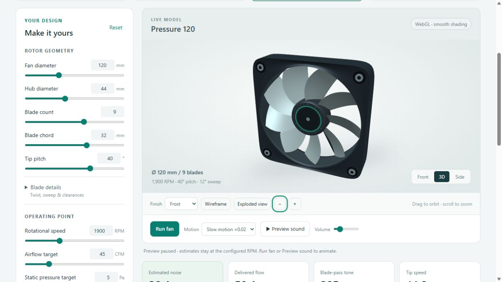
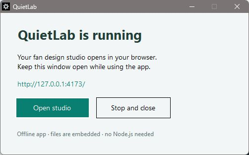
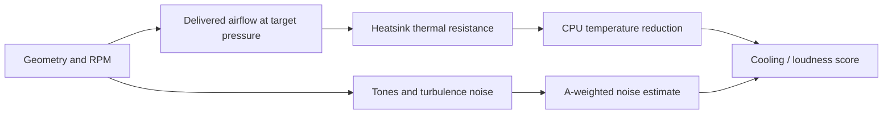
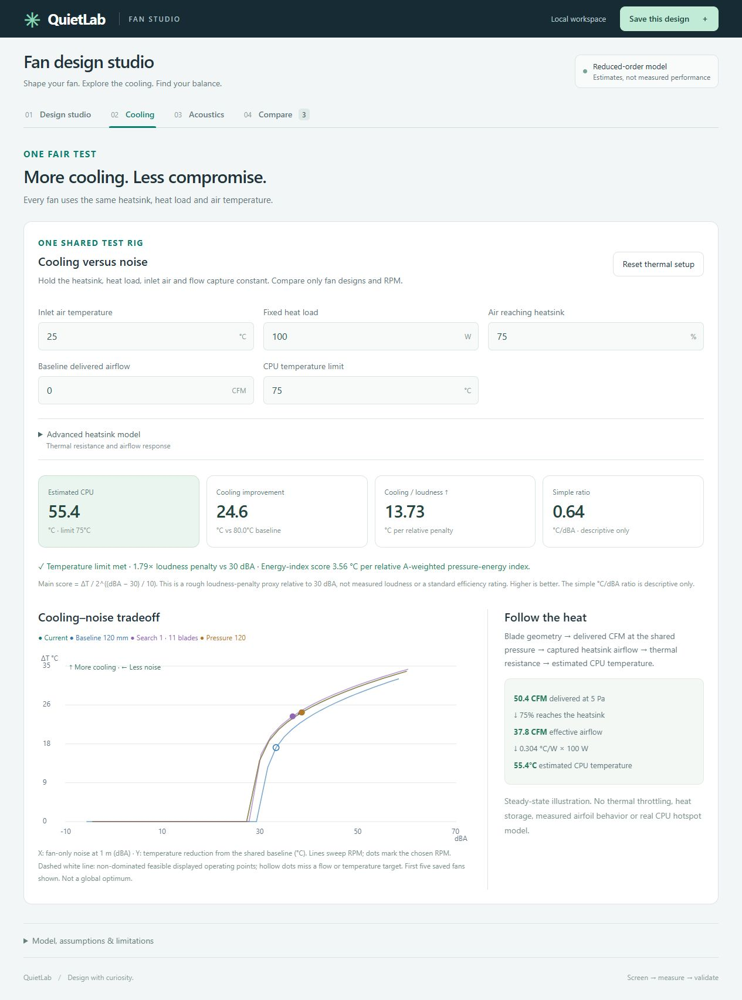
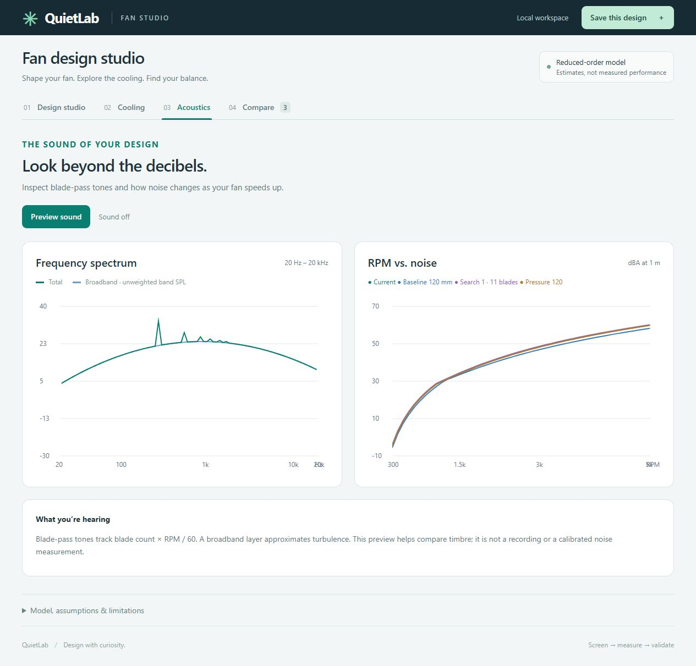

# QuietLab

**An open-source fan design studio for exploring the balance between cooling and noise.**

Model a PC-style axial fan, listen to a synthetic preview, compare designs under a shared thermal setup, and search for quieter geometry that still delivers the airflow you need.



> QuietLab is reduced-order screening. Noise and temperature estimates are uncalibrated; this is not CFD/CAA, a measured fan rating, or a structural safety assessment.

## Get started

### Public website with GitHub Pages

QuietLab runs entirely in the visitor's browser. Upload this repository to GitHub, then select **Settings → Pages → Source → GitHub Actions**. Under **Actions**, run **Publish website**. Its successful deployment exposes the public website URL. Later pushes to `main` publish updates automatically.

No installation or account is required for visitors. Saved designs are local to each browser; use Export JSON for backups. See [website publishing instructions](docs/PUBLISH_WEBSITE.md).

### Windows: no Node.js required

1. Download `QuietLab-Windows.zip` from this repository's **Releases** page.
2. Extract the archive and open `QuietLab.exe`.
3. The studio opens in your default browser. Keep the small launcher window open; **Stop and close** ends its local server.

The single executable embeds all web assets. It targets Windows 10/11 with the Windows .NET Framework 4.x runtime and a current browser. There is no installer, account or remote runtime dependency. The executable is unsigned. Release assets include SHA-256 checksums; see [release notes](docs/RELEASE_NOTES.md).



### Source: Windows, macOS or Linux

Use Node.js 20 or newer:

```sh
npm start
```

Open `http://127.0.0.1:4173/`. No `npm install` or build step is required. Keep the server terminal open during use. On Windows, `Start QuietLab.cmd` also launches the studio.

You can open `dist/index.html` directly for offline use. Browser storage behavior varies for file URLs; the local server is recommended. Saved designs remain in your browser, and **Export JSON** makes a backup.

## What you can do

- Edit diameter, hub, blade count, chord, pitch, twist, sweep, thickness and clearance.
- Start with Balanced 120, Quiet 140, Pressure 120 or Compact 80: generic, editable concepts.
- Inspect smooth 3D blades, housing hardware, front/side views, wireframe and exploded view.
- Link blade rotation and synthetic sound to the same RPM; inspect shapes in slow motion.
- Inspect tip speed, blade-pass frequency, airflow/pressure, spectrum and estimated dBA/SPL.
- Compare CPU-temperature reduction and noise with a shared heatsink, heat load and inlet temperature.
- Save designs locally, compare them, and export their parameters.
- Search 1,600 geometry candidates for low noise or a better cooling/loudness score, subject to operating targets.

## A simple workflow

1. **Design studio:** choose a fan preset and change the shape or RPM. Set airflow and pressure targets. Blade details are available in the expandable panel.
2. **Cooling:** set inlet temperature, heat load, baseline airflow and CPU limit. Advanced heatsink coefficients are adjustable. All compared fans share these conditions.
3. **Acoustics:** preview the sound and inspect its spectrum. Volume is a playback control; it does not change cooling or RPM.
4. **Compare:** save a baseline, try another fan, and compare the operating points.
5. **Explore better designs:** choose the search objective, apply a candidate, and save it for comparison.

Higher cooling/loudness score is better under the same shared test rig. Upper-left on the cooling/noise plot means more cooling with less noise. A result must still meet your airflow and, in cooling search mode, CPU-temperature target.

## How the model works



Tip speed is `π × diameter × RPM / 60`. Blade-pass frequency is `blade count × RPM / 60`. A heuristic fan curve estimates free-air flow and shutoff pressure, then computes delivered airflow at your selected pressure.

The noise model combines six blade-pass harmonics with broadband energy across 80 logarithmic bands. It applies A-weighting before summing energy. The thermal model maps captured airflow to a saturating thermal-resistance curve; CPU temperature is inlet temperature plus heat load times resistance.

The main score is:

```text
Cooling / loudness score = temperature reduction / 2^((dBA − 30)/10)
```

This is a rough relative-loudness penalty with a fixed 30 dBA reference, not standardized loudness. The app also shows the descriptive °C/dBA ratio and an energy-index score. The geometry search uses the same documented model, so it can find a good candidate under those assumptions without proving that a real fan will perform that way.

See [How it works](docs/HOW_IT_WORKS.md) for equations, implementation, units, search behavior, limitations and primary references, or the [user guide](docs/USER_GUIDE.md). No accuracy bounds are claimed. Validate absolute values and geometry rankings against measurements before using them for physical design decisions.

## Screenshots

### Shared cooling and noise comparison



### Acoustic spectrum and speed curve



All pictures are captures of the actual application. The model presets and rendered housing are generic concepts.

## Build the Windows executable

The source for the launcher is included. On Windows:

```powershell
powershell -NoProfile -ExecutionPolicy Bypass -File windows/build.ps1
powershell -NoProfile -ExecutionPolicy Bypass -File windows/test.ps1
```

The build uses the Windows .NET Framework C# compiler and built-in libraries. It produces `release/QuietLab.exe`, embeds the six current web assets and does not download dependencies. The test verifies that each embedded asset matches its source and checks the local server. No admin installation is needed to run it. Build outputs are ignored by Git and are intended for release assets.

## Development

```sh
npm test
```

The checks cover fan affinity scaling, pressure-limited flow, acoustic energy, A-weighting, thermal consistency, noise scoring, search constraints, Pareto filtering, RPM motion and valid mesh geometry. GitHub Actions runs the model checks and builds/tests the Windows launcher. A version tag triggers the release workflow.

| Location | Purpose |
|---|---|
| `dist/` | Dependency-free browser app and source |
| `windows/` | Open-source executable launcher and build/test scripts |
| `docs/` | Model explanation, release notes and app pictures |
| `test.cjs` | Numerical and geometry checks |
| `.github/workflows/` | Continuous integration and Windows releases |

Contributions are welcome; see [CONTRIBUTING.md](CONTRIBUTING.md). Source, documentation and original visuals are available under the [MIT license](LICENSE).
