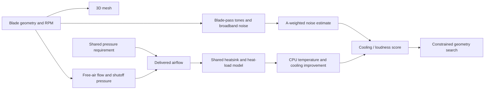

# How QuietLab works

QuietLab turns a small set of axial-fan dimensions and operating targets into a visible 3D rotor, a flow/pressure screening estimate, a sound spectrum and an illustrative cooling result. Every calculation runs locally.



## 1. Geometry and motion

The editor sets rotor diameter, hub diameter, blade count, chord, tip pitch, root twist, sweep, maximum thickness, tip clearance and a housing switch. The model is a PC-style axial fan.

`rotor3d.js` builds smooth parametric surfaces and renders them with WebGL depth testing and directional lighting. Rounded blade sections taper along the radius. Blade tips remain within the requested rotor diameter. Housing fasteners and supports are visual context; they are not independently resolved by the physics model. Frost, Graphite, Mint, wireframe and exploded view affect the preview only. A simpler software renderer is used when WebGL is unavailable.

Four generic starting points are included: Balanced 120, Quiet 140, Pressure 120 and Compact 80. They are editable concepts rather than measured commercial products.

Rotation follows:

`angular change = 2π × RPM / 60 × elapsed seconds`

The blade-passing frequency is:

`BPF = blade count × RPM / 60`

Audio and rotation use the same configured RPM. Slow motion multiplies visual time by 0.02 without lowering audio pitch. Display refresh rates can alias rapid blade motion; apparent reverse rotation does not indicate a physics result. Pausing the preview leaves estimates at the configured operating point.

## 2. Airflow and static pressure

Units: diameter and hub in metres for calculations, air density `ρ = 1.204 kg/m³`, speed of sound `343 m/s`.

```text
tip speed U = π × diameter × RPM / 60
annular area A = π × (diameter² − hub²) / 4
solidity σ = blade count × chord / mean circumference
effective pitch α = tip pitch + 0.35 × root twist
stall factor = 1 / (1 + max(0, pitch + 0.65 × twist − 45)² / 220)
loading = (1 − exp(−1.8σ)) × sin(2α) × stall factor
```

Leakage is `exp(−k × clearance / diameter)`, with `k = 3` for a housing and `7` without one; unhoused fans get an additional `0.78` factor.

```text
free-air flow Q₀ = 0.30 × A × U × loading × leakage
shutoff pressure P₀ = 0.20 × ½ρU² × loading × leakage
delivered flow Q = Q₀ × sqrt(max(0, 1 − target pressure / P₀))
```

Flow converts from m³/s to CFM using `2118.88`. The assumed parabolic fan curve intersects an imposed constant pressure requirement. It is not a measured radiator system curve. Maximum flow and maximum pressure do not occur at the same operating point.

These relationships preserve familiar affinity behavior: doubling speed at fixed geometry doubles free-air flow and quadruples shutoff pressure. Geometry coefficients and stall/leakage corrections are illustrative.

## 3. Noise and sound preview

Noise starts from an arbitrary `30 dB` reference at `120 mm / 1,500 RPM`, a `50 log₁₀(tip-speed ratio)` scaling, and an area correction. Solidity, thickness, clearance, loading, housing and sweep contribute heuristic adjustments. The source in `model.js` is the authoritative coefficient definition.

Broadband energy is distributed into 80 logarithmic bands between 20 Hz and 20 kHz. Six blade-pass harmonics decrease by `7 log₂(harmonic order)` dB. Acoustic energies are summed in the linear domain; A-weighting is applied to each tone and broadband band before summation. Spectrum levels are integrated band SPL rather than dB/Hz.

The sound preview uses oscillators at the harmonic frequencies plus filtered noise. The noise filter approximates the spectrum rather than recreating every plotted band. Playback volume is a user comfort control and does not reproduce the predicted absolute SPL. The score is fan-only at an assumed 1 m in a free field; room background and other fans are omitted.

## 4. Cooling

All compared designs use the current shared inlet temperature, heat load, heatsink coefficients, flow-capture fraction, baseline delivered airflow and temperature limit.

```text
captured airflow = delivered CFM × capture fraction
Rθ(Q) = Rmin + (Rno-flow − Rmin) / (1 + (captured airflow / flow scale)^exponent)
CPU temperature = inlet temperature + heat load × Rθ(Q)
cooling improvement ΔT = baseline temperature − CPU temperature
```

The baseline uses the same equation and rig at the specified baseline delivered airflow. With the default 25°C inlet, 100 W heat load, 0.55°C/W no-flow resistance and zero baseline flow, baseline temperature is 80°C. Negative improvement means worse cooling than that baseline.

The model is steady-state. Thermal throttling, transients, CPU hotspots, actual heatpipe behavior and case recirculation are not resolved. Flow capture is a simplified placement/ducting surrogate. The baseline can exceed a real CPU's operating limit because throttling is absent.

## 5. Cooling / noise metrics

| Metric | Definition | Interpretation |
|---|---|---|
| Simple ratio | `ΔT / dBA` | Descriptive only; undefined for nonpositive dBA |
| Main score | `ΔT / 2^((dBA − 30)/10)` | Cooling per relative loudness-penalty proxy |
| Energy-index score | `ΔT / 10^((dBA − 30)/10)` | Cooling per relative A-weighted mean-square pressure index |

The main penalty doubles for a 10 dB increase; the energy penalty increases tenfold. The fixed reference is 30 dBA. The main score is not standardized psychoacoustic loudness, and the energy index is not sound power in watts or motor efficiency. Neither is a calibrated engineering efficiency rating.

The cooling/noise plot places noise on the horizontal axis and temperature reduction on the vertical axis. Upper-left offers more cooling with less noise. Curves sweep RPM; dots show selected operating points. The dashed frontier connects non-dominated feasible displayed operating points, not a global optimum. Hollow dots miss a flow or temperature target.

## 6. Search

The seeded search explores 1,600 geometries. Diameter, hub, thickness, clearance, housing and all shared test conditions stay fixed. Blade count, chord, pitch, twist, sweep and RPM vary.

For each geometry it solves the minimum RPM meeting the targets by bounded search between 300 and 5,000 RPM, rounded to 50 RPM. Cooling mode additionally samples 12 higher speeds and chooses the best main score while meeting flow, CPU-temperature and positive-cooling-improvement constraints. Noise-only mode minimizes predicted dBA at the airflow target and does not enforce the thermal limit.

The search rejects solidity above 1.35, modeled stall factor below 0.85 and tip Mach above 0.15. These filters do not establish structural safety. Results are the best of the sampled candidates under this model, not proof of a physical optimum.

## 7. Local architecture and data

| File | Role |
|---|---|
| `dist/index.html`, `style.css` | Layout and presentation |
| `dist/app.js` | Controls, charts, storage, sound and comparison workflow |
| `dist/rotor3d.js` | Smooth meshes and local WebGL rendering |
| `dist/model.js` | Flow, pressure, spectrum, A-weighting and search |
| `dist/thermal.js` | Thermal model, scores, Pareto comparison and rotation math |
| `server.cjs` | Optional Node.js loopback server |
| `windows/QuietLab.cs` | Windows launcher with embedded web assets and loopback server |

The app has no telemetry or remote runtime dependencies. Saved fans and thermal settings use browser local storage. Export JSON is a backup. File URLs, different browsers, cleared storage and different server ports can have different storage origins.

The executable prefers port 4173 and falls back to a free local port if occupied. Its launcher window shows the actual URL. Closing that window stops its server; closing only the browser does not. The executable contains the same six web assets as the source directory and needs the Windows .NET Framework 4.x runtime. It uses the default browser rather than bundling a browser engine.

## 8. Limitations and validation

QuietLab is **reduced-order screening, not CFD/CAA or calibrated thermal validation**. Absolute noise and temperatures, and even geometry rankings, need experimental verification. No error bounds are claimed. Missing effects include motor/bearing noise, mounts, grille/stator interactions, actual boundary layers, tip vortices, strength, motor power and overspeed.

To calibrate it, measure a baseline fan's flow/pressure curve, RPM, 1 m spectrum, heat load and heatsink temperatures. Fit a subset of measurements and evaluate on held-out speeds and geometries. Keep individual measurements and installation conditions with the dataset, and report both fitted and held-out errors.

## Foundational references

- [AMCA fan noise and speed scaling](https://www.amca.org/assets/resources/public/assets/uploads/FINAL-_AMCA_Fan_Noise_RG.pdf)
- [NASA: Broadband Fan Noise Generated by Small Scale Turbulence](https://ntrs.nasa.gov/archive/nasa/casi.ntrs.nasa.gov/19980119846.pdf)
- [NIOSH Industrial Noise Control Manual](https://www.cdc.gov/niosh/docs/75-183/pdfs/75-183.pdf)
- [Noctua: CPU temperature and ventilation](https://www.noctua.at/en/support/faqs/why-is-my-cpu-temperature-so-high)

These support the physical concepts and context. They do not validate QuietLab's chosen coefficients.
